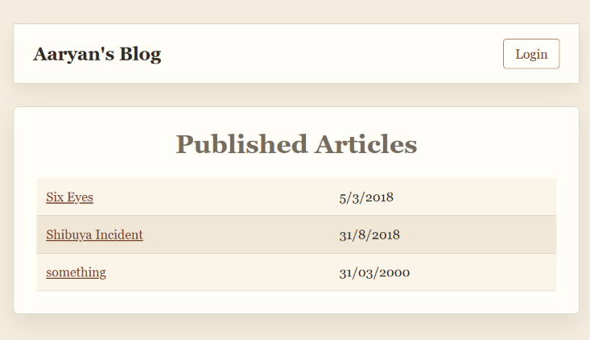

# Personal Blog

A small server-rendered personal blog built with Flask. Visitors can read published articles, while the admin can log in and manage articles through a separate dashboard. This project is my implementation of [Personal Blog Project](https://roadmap.sh/projects/personal-blog) from roadmap.sh. 

## Features

- View a list of published articles
- Open an individual article page
- Admin login using Flask sessions
- Create, edit, and delete articles
- Store articles in a JSON file
- CSRF protection for forms
- Flash messages for successful actions
- Responsive paper-style interface

## Screenshot




## Requirements

- Python 3
- Flask
- Flask-WTF

## Setup

Clone the repository and move into the project directory:

```bash
git clone https://github.com/Aaaryan-J/mini_backend_projects.git
cd mini_backend_projects/blog_webapp
```

Create a virtual environment:

```bash
python -m venv .venv
```

Activate it in Windows PowerShell:

```powershell
.\.venv\Scripts\Activate.ps1
```

Install the dependencies:

```bash
pip install -r requirements.txt
```

## Run the application

```bash
python app.py
```

Open the blog at:

```text
http://127.0.0.1:5000/
```

The development admin credentials are:

```text
Username: admin
Password: secret
```

## Routes

| Route | Description |
|---|---|
| `/home` | View published articles |
| `/article/<id>` | View one article |
| `/login` | Admin login |
| `/admin` | Admin dashboard |
| `/new` | Create an article |
| `/edit/<id>` | Edit an article |
| `/delete/<id>` | Delete an article |
| `/logout` | Log out of the admin session |

## Project structure

```text
blog_webapp/
├── app.py
├── articles.json
├── requirements.txt
├── static/
│   └── style.css
└── templates/
    ├── admin.html
    ├── article.html
    ├── home.html
    ├── login.html
    ├── new_article.html
    └── update_article.html
```

## Built with

- Python
- Flask
- Jinja
- Flask-WTF
- HTML
- CSS

In the future I might extend this project by adding features like comments, categories, tags, search functionality, and more.