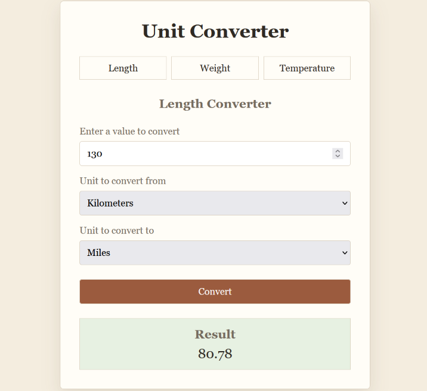

# Unit Converter

A Flask web application that converts values between length, weight, and temperature units.

## Features

- Length conversion:
  - Meters
  - Kilometers
  - Miles
- Weight conversion:
  - Grams
  - Kilograms
  - Pounds
- Temperature conversion:
  - Celsius
  - Fahrenheit
  - Kelvin
- Separate routes for each measurement type
- Form validation and error messages
- Paper-style responsive user interface

## Screenshot




## Requirements

- Python 3
- Flask

## Installation

Clone the repository and move into the project directory:

```bash
git clone https://github.com/Aaaryan-J/mini_backend_projects.git
cd mini_backend_projects/unit_converter
```

Create and activate a virtual environment:

```bash
python -m venv .venv
```

Windows PowerShell:

```powershell
.\.venv\Scripts\Activate.ps1
```

Install Flask:

```bash
pip install flask
```

## Running the application

```bash
python app.py
```

Open the application at:

```text
http://127.0.0.1:5000/
```

## Routes

| Route | Description |
|---|---|
| `/length` | Convert length values |
| `/weight` | Convert weight values |
| `/temperature` | Convert temperature values |

The root route (`/`) redirects to `/length`.

## Project structure

```text
unit_converter/
├── app.py
├── static/
│   └── style.css
├── templates/
│   └── index.html
└── README.md
```

## Built with

- Python
- Flask
- Jinja
- HTML
- CSS
